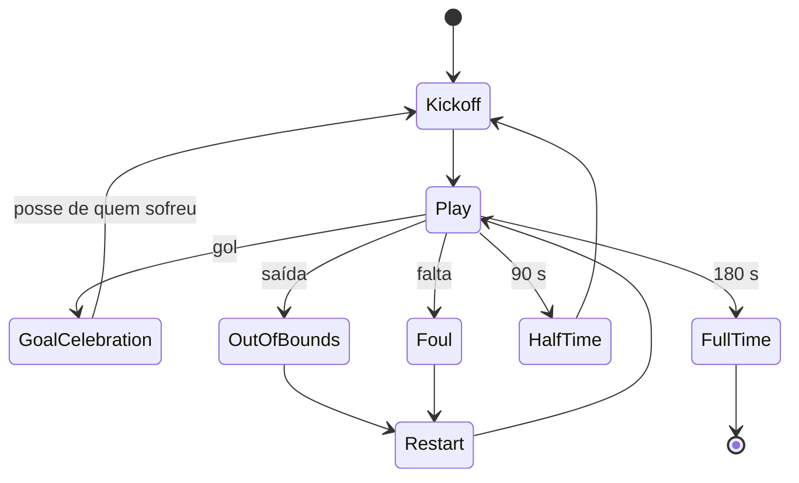

# Mecânicas de partida

[Índice](README.md) · [Conteúdo e carreira →](03-conteudo-e-carreira.md)

## Regras e estados — MEC-001

7v7, um goleiro e seis atletas de linha por equipe. Tempo ativo: **2 × 90 s**, intervalo de 10 s; 3 substituições, no intervalo ou em bola parada. Campo 1.600 × 1.000 u; área 300 × 420 u; gol 160 u de largura e 100 u de profundidade. Empates são válidos na liga; a classificação usa vitória 3, empate 1, derrota 0 **pontos**.

## Movimento, seleção e posse — MEC-002–005

| Papel | Velocidade base u/s | Aceleração u/s² | Desaceleração u/s² | Giro rad/s | Sprint × |
| --- | ---: | ---: | ---: | ---: | ---: |
| GOL | 220 | 900 | 1.400 | 6 | 1,0 |
| ZG | 250 | 1.100 | 1.600 | 5 | 1,25 |
| LAT | 285 | 1.300 | 1.500 | 6,5 | 1,35 |
| MEI | 270 | 1.250 | 1.550 | 6,5 | 1,30 |
| ATA | 295 | 1.400 | 1.350 | 6 | 1,40 |

`velMax_efetiva = velMax_base × (0,70 + 0,30 × velocidade/100) × forma`.

A seleção prioriza o atleta mais próximo da bola dentro de 260 u; troca automática após 0,6 s sem posse ou manual via Tab/botão. Histerese de 40 u evita oscilação entre candidatos. O selecionado recebe anel âmbar com indicação não dependente apenas da cor.

Sprint via Shift ou touch: dreno base 8/s; recuperação 4,5/s parado e 2/s andando. Abaixo de 25 de estamina: velocidade ×0,82 e passe −8 pontos percentuais; abaixo de 10, sprint bloqueado e feedback de arfada. A estamina residual persiste. O físico também deve influenciar o dreno, sujeito à calibração.

Posse é mantida a até 24 u; a bola escapa acima dessa distância. Proteção, ao orientar-se contra o adversário, reduz velocidade em 25% e aumenta resistência ao desarme em 20%. Distância do toque: `26 + 0,12 × velocidade_atual` u.

## Bola e passe — MEC-006–008

Bola circular de raio 12 u, atrito exponencial 1,15/s, restituição 0,58 e velocidade máxima 1.400 u/s. Não há spin; chance de controle por toque proposta: 92%.

Passe seleciona companheiro alinhado ao vetor de input em cone de 55°, desempate por distância. Carregar o botão determina o tipo:

| Tipo | Carga | Alcance pretendido | Velocidade | Erro base |
| --- | --- | --- | ---: | ---: |
| Curto | < 180 ms | 120–450 u | 480 u/s | ±5° |
| Médio | 180–450 ms | 450–800 u | 620 u/s | ±8° |
| Longo/cruzamento | > 450 ms | 800–1.300 u | 780 u/s | ±12° |

`erro = erroBase × (1,35 − 0,70 × passe/100) × min(1 + 0,25 × adversários a menos de 180 u, 1,75)`.

Correção anti-frustração evita passe involuntário para fora quando há companheiro no cone. Cruzamento ignora disputa de solo até a área; duelo aéreo a 60 u do ponto de queda usa força + metade da altura + variação de −10 a +10; cabeceio tem erro base ±18°, modulado por finalização. A altura não integra os seis atributos e precisa de definição.

## Chute — MEC-009

Segurar K/botão: carga linear de 0 a 100 em 900 ms, saturada; disparo no release. A bola sempre viaja pela física; a tabela de chances é uma **expectativa estatística**, não sorteio de gol no disparo.

| Zona | Expectativa base (força 70, finalização 60) | Observação |
| --- | ---: | --- |
| Canto baixo | 34% | Modificador `+0,30 × (fin/100 − 0,5)` |
| Canto alto | 26% | `−0,15` se altura < 50 |
| Centro | 18% | Goleiro +12% de defesa |
| Fora da área (> 620 u) | 9% | `−0,20` a cada 100 u além da área |

`chance_gol = base_zona + curva_finalizacao + bonus_ângulo − goleiro_reflexo`. A fórmula original do bônus contém `clamp(..., 0, 0)`, sempre zero: veja [conflitos](11-riscos-decisoes-e-auditoria.md#conflitos-que-exigem-resolução).

## Defesa, marcação e goleiro — MEC-010–013

Bote via L/botão, janela de 400 ms. A intenção é diferenciar contato bola-primeiro de contato adversário-primeiro; o fluxograma do GDD contém um conflito com o cenário de teste, que deve ser resolvido antes da implementação. Para disputa: `(defesa + força)/2 + random(−8,+8)` contra `(drible + força)/2 + random(−8,+8)`. Em ângulo desfavorável: falta 60%; duelo perdido: 25% de falta. Os dois atletas mais próximos pressionam por 2,5 s após perder a posse; desarme de IA aliada tem eficácia relativa 0,70.

Goleiro: posiciona-se 40 u à frente da linha quando a bola está longe (>700 u), sai até 120 u na área, calcula interceptação de chute e fecha o ângulo em 15° no 1v1. Reflexo proposto: `55 + 0,35 × atributo_reflexos`. Atributo de reflexos e o limiar de chute “inevitável” não foram definidos nos seis atributos; ver [auditoria](11-riscos-decisoes-e-auditoria.md). Goleiro em posse é controlável para repor a bola.

## IA, formação e assistência — MEC-014–019

Utility AI seleciona comportamentos; steering executa seek, arrive, pursue e separation. Percepção a 10 Hz. Papéis: goleiro protege; zagueiro apoia e marca zona; lateral dá amplitude; volante distribui e pressiona; meia cria; atacante busca profundidade.

| Dificuldade | Reação | Erro de decisão | Pressão | Bônus goleiro |
| --- | ---: | ---: | ---: | ---: |
| Amador | 480 ms | 22% | 0,60 | 0 |
| Profissional | 320 ms | 12% | 0,80 | +5 |
| Elite | 200 ms | 6% | 1,00 | +10 |
| Lendário | 140 ms | 3% | 1,15 | +15 |

Erro de decisão é escolha da segunda melhor opção; IA não lê o input humano no mesmo frame. Formações: **2-3-1**, **3-2-1**, **1-2-2-1**, **2-1-1-2**. Cinco instruções: postura, pressão, amplitude, tempo de posse e marcação. Pressão alta acrescenta 0,2 à intensidade e multiplica dreno por 1,3; faixas de pressão: 220/320/420 u.

Assistência **Total** mira automaticamente no companheiro mais alinhado e no canto aberto; **Parcial** amplia cone em 60% e reduz erro em 40%; **Nenhuma** usa vetor cru. A assistência só altera o vetor inicial, não a física após disparo.

## Reinícios e disciplina — MEC-020, 024, 025

| Reinício | Gatilho | Execução | Duração prevista |
| --- | --- | --- | ---: |
| Lateral | Bola cruza linha lateral | Passe médio automático ao mais próximo | 1,2 s |
| Escanteio | Sai pelo fundo com último toque da defesa | Cruzamento automático | 2 s |
| Tiro de meta | Sai pelo fundo com último toque do ataque | Passe longo do goleiro | 1,5 s |
| Falta | Desarme ilegal | Passe, cruzamento ou chute a até 700 u | 3 s |
| Pênalti | Falta na área | Mira e força | 4 s |
| Saída | Início ou gol | Passe curto ao volante | 1 s |

IA não pressiona durante o reinício; mobile deve oferecer pular. Cartão amarelo em 25% das faltas, 45% por trás; dois amarelos expulsam; vermelho direto para falta na área como último defensor em 15% dos casos. Suspensão por amarelos acumulados em duas partidas. O GDD também afirma que nenhum time joga com menos de seis; resolver comportamento de uma segunda expulsão. O pênalti detalhado é classificado como Should embora sua ocorrência seja Must.

## Simulação rápida — MEC-022

`ataque = média(finalização dos atacantes) × (1 + tática_ofensiva × 0,1) × forma`; defesa equivalente com zagueiros e defesa. Para cada lado: `λ = clamp(0,35 + (ataqueA − defesaB)/120, 0,25, 3,2)`; gols seguem Poisson. Resolver uma vez por partida, com placar e três eventos-chave, sem reroll. Concede CR e resultado, mas não XP de partida. Comparar médias com partida jogada conforme TST-021; metas e fórmula apresentam conflito, documentado na auditoria.
