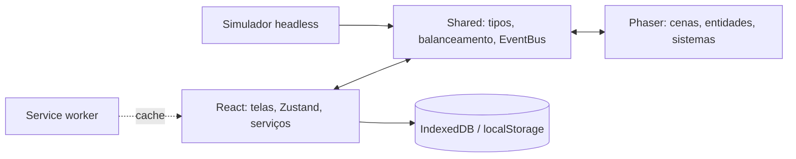

# Arquitetura técnica

[Índice](README.md) · [Economia e balanceamento →](07-economia-e-balanceamento.md)

## Stack e dependências-alvo

React 18.3+, Phaser 3.80+, TypeScript strict com `noUncheckedIndexedAccess`, Vite 5, Zustand 4.5+, Tailwind 3.4+, Vitest 2, `idb-keyval` 6, `vite-plugin-pwa` 0.20+ e `eventemitter3` 5. Orçamento: até dez dependências diretas de runtime; novas dependências exigem ADR. Versões são as planejadas no GDD, não uma auditoria atual de compatibilidade.

## Fronteiras

1. `src/app/**` não importa de `src/game/**` e vice-versa; ambos podem usar `src/shared/**`.
2. Phaser não escreve no storage: emite resultado, React aplica e persiste.
3. Zustand é fonte de verdade da carreira; partida recebe snapshot imutável e retorna resultado.
4. O simulador headless compartilha fórmulas de balanceamento e tem médias comparadas com a cena de jogo.
5. PRNG `mulberry32` e estado da seed persistidos; evitar `Math.random()` no domínio.

Um único `Phaser.Game`, trocas via `scene.start()` e limpeza de listeners no `shutdown()`. Cenas previstas: Boot → Preload → Menu → Match → Result; pausa retorna a Match; falha de asset leva a Error.

## Contratos essenciais

- `ClubId` e `PlayerId`: strings com marca de tipo.
- `Role`: GOL, ZG, LAT, VOL, MEI, ATA.
- `Attributes`: velocidade, passe, finalização, drible, defesa e físico, 1–100.
- `MatchConfig`: seed, snapshots imutáveis das duas equipes, duração 180 s, assistência e dificuldade.
- `MatchResult`: placares inteiros, eventos, posse, chutes, desarmes e ratings por jogador.
- `SaveGame`: versão de schema 3, versão do jogo, datas, metadados, mundo, liga, calendário, elenco, comissão, loja, configurações e estado do PRNG.

## EventBus

Payloads imutáveis e serializáveis; nenhum objeto Phaser atravessa a fronteira. Comunicação fire-and-forget. `match:tick` limitado a 4 Hz; remover listeners no shutdown. O contrato textual e a tabela originais divergem; os eventos abaixo representam a intenção combinada, **não um contrato já implementado**.

| Evento | Direção pretendida | Payload resumido |
| --- | --- | --- |
| `match:start` | React → jogo | configuração da partida |
| `match:tick` | jogo → React | tempo e placar |
| `match:goal` | jogo → React | atleta, equipe, minuto, placar |
| `match:card` | jogo → React | atleta, equipe, tipo, minuto |
| `match:event` | jogo → React | evento de partida |
| `match:tactic` | React → jogo | tática parcial |
| `match:pause` | bidirecional | estado de pausa; motivo requer definição |
| `match:end` | jogo → React | resultado completo |
| `match:error` | jogo → React | código e mensagem |
| `input:action` | React → jogo | ação touch, potência e/ou vetor |
| `scene:ready` / `scene:resize` | jogo → React / React → jogo | prontidão / tamanho e DPR |
| `save:request` / `save:complete` / `save:error` | React ↔ serviço | slot, data ou erro |
| `save:import` / `save:export` | React ↔ serviço | JSON |
| `audio:mute` | React → áudio | estado de mudo |
| `ui:toast` | jogo → React | mensagem e tipo |

A numeração EVT do original tem colisão: EVT-020 é usado como `match:end` em um trecho e `save:export` na tabela; `match:end` é EVT-008 na tabela. Unificar antes do código.

## Save e PWA

IndexedDB via `idb-keyval`, banco `FC_Saves`, três slots + autosave; fallback `localStorage` com chave `fc.save.N` quando IndexedDB não estiver disponível. Autosave após partida e ação de gestão; manter backup do último autosave válido. Migração planejada v1 → v2 → v3; versões desconhecidas rejeitadas com mensagem clara. Exportação JSON inclui schema e checksum; importação valida antes de alterar save. Aviso > 4 MB, bloqueio > 8 MB. Não há telemetria nem backend.

O GDD propõe debounce de 2 s e, simultaneamente, persistência confirmada antes da tela de resultado e proteção contra fechamento imediato. A semântica transacional e recuperação após crash precisam ser definidas; debounce isolado não garante essas propriedades.

PWA planejado com `vite-plugin-pwa`, `registerType: autoUpdate`, precache de shell/assets/fontes e CacheFirst para assets. Offline após primeiro carregamento. Banner de atualização previsto; sua interação com autoUpdate requer definição. `file://` sem service worker deve degradar graciosamente, mas carregamento de módulos/chunks pode impor limitações reais a validar.

## ADRs

| ID | Decisão | Principal consequência |
| --- | --- | --- |
| ADR-01 | Zustand | Estado leve e testável, sem time travel nativo por padrão |
| ADR-02 | IndexedDB com fallback | Dois backends atrás de interface única |
| ADR-03 | Arcade Physics, não Matter.js | Simplicidade; sem física de rotação complexa |
| ADR-04 | Pixel art 32 × 32 e atlas | Legibilidade e identidade, menos detalhe |
| ADR-05 | Simulador headless e fórmulas comuns | Necessário validar convergência com a partida jogada |
| ADR-06 | EventEmitter3 encapsulado em bus tipado | Desacoplamento React–Phaser |
| ADR-07 | Seed determinística | Reprodutibilidade exige controle rigoroso do RNG e inputs |
| ADR-08 | Tailwind versus CSS Modules | Pendente: adicionar na implementação |
